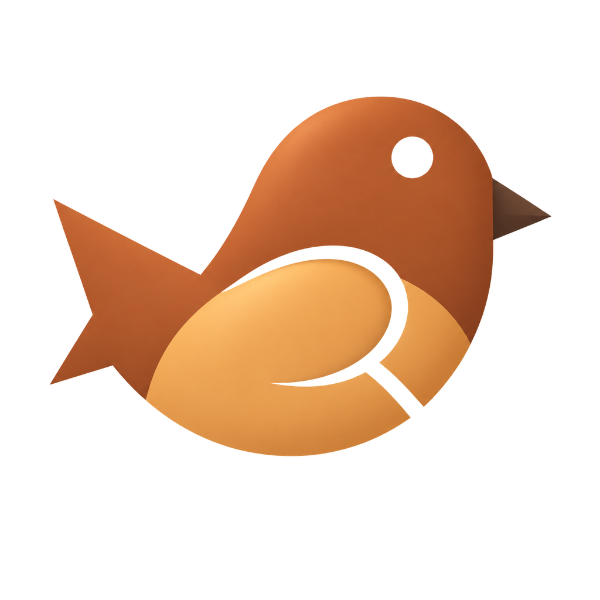
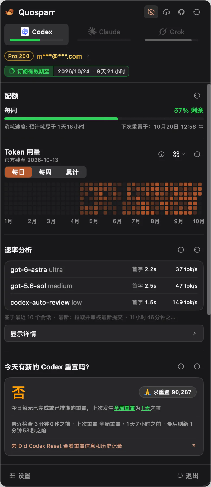
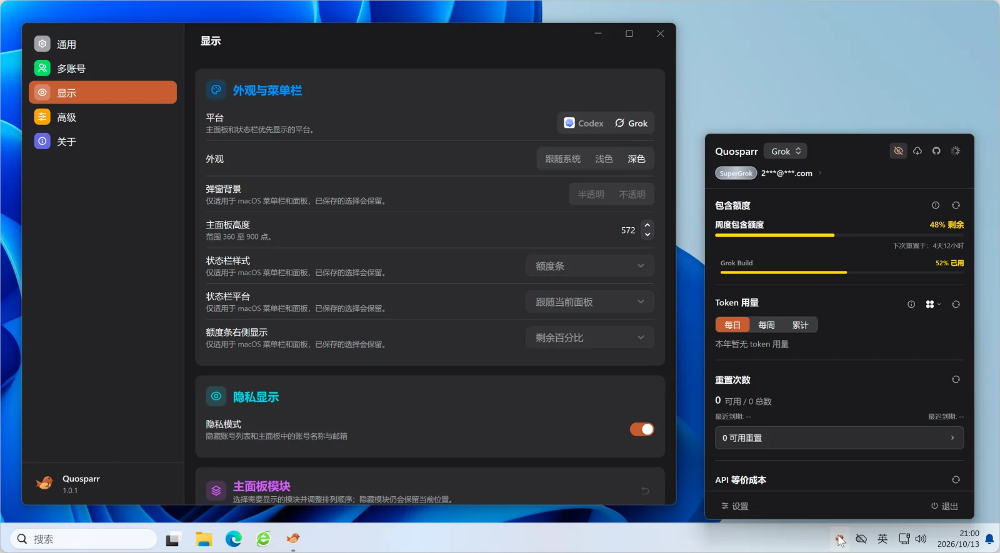
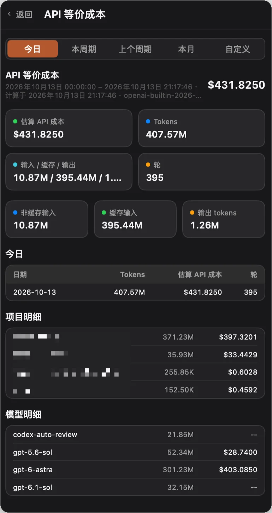
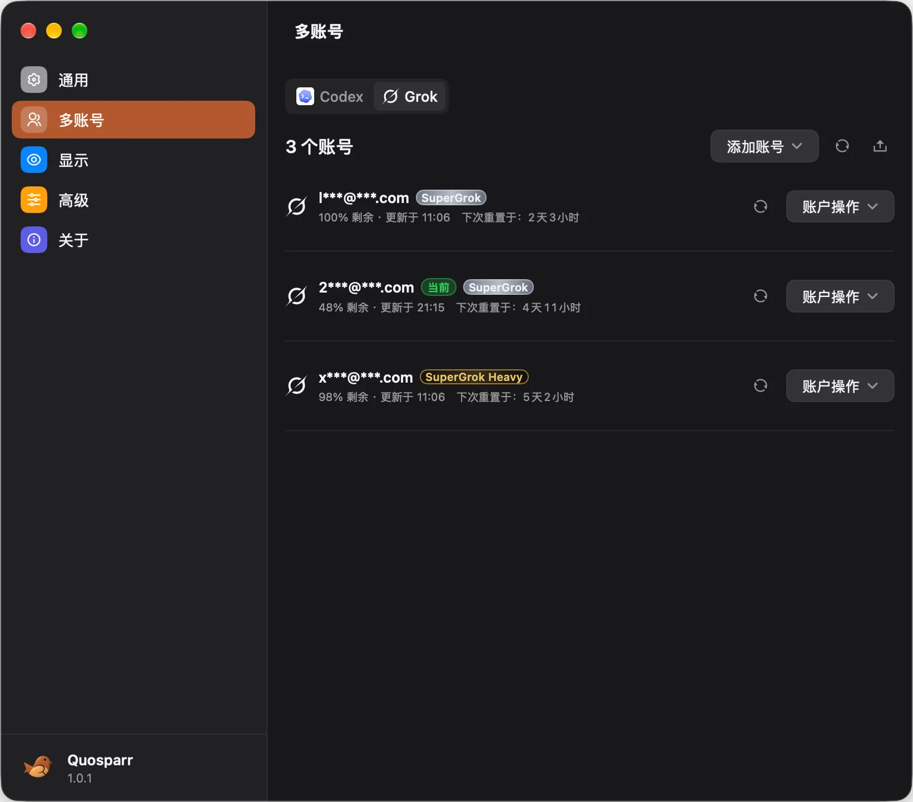
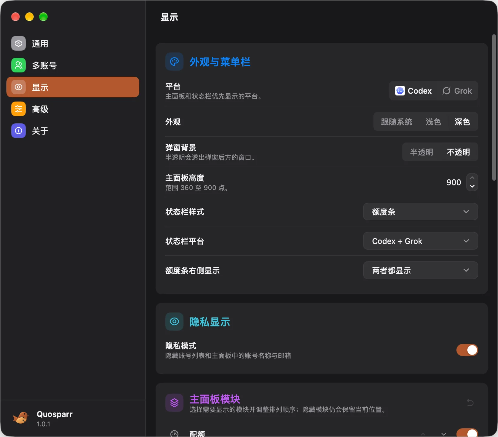
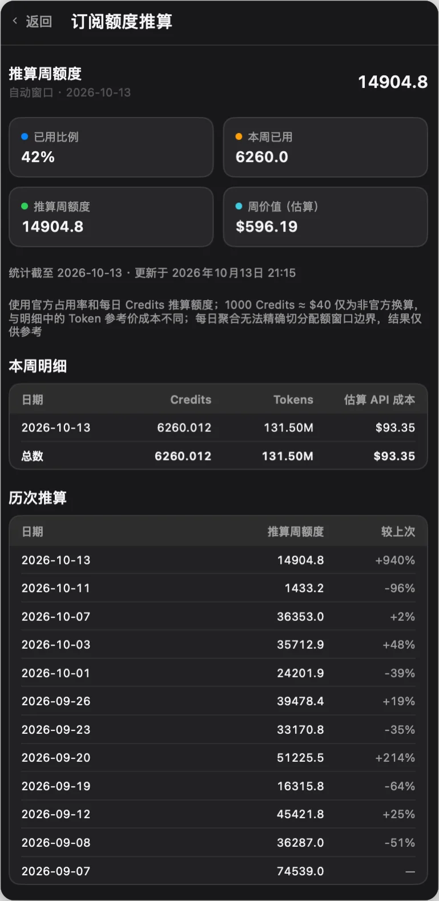

[English](./README.md) · [简体中文](./README_ZH.md) · 繁體中文 · [한국어](./README_KO.md) · [日本語](./README_JA.md) · [Русский](./README_RU.md) · [Français](./README_FR.md)

<div align="center">



# Quosparr

<sub><i>名稱取自 <b>Quo</b>ta（額度）+ <b>Sparr</b>ow（麻雀）</i></sub>

一隻停在選單列裡的小麻雀，替你守著 Codex 與 Grok 的額度。

Quosparr 是適用於 macOS、Windows、Linux 的原生選單列 / 系統匣應用程式，顯示 Codex 與 Grok 額度、reset credits、API 等價成本與本機工作階段，兩個供應商各自獨立管理多帳號。

</div>

## 亮點

**Codex**

- 查看 5 小時、每週與附加額度視窗的剩餘額度，以及目前帳號、訂閱等級和到期時間。
- 查看 reset credits 數量、狀態與到期時間。
- 根據官方週用量百分比與每日 Credits 推算本週額度，並與前幾週比較，方便發現額度被調降。
- Codex 重設動態：查看今天 Codex 速率限制是否已重置，可單獨設定重新整理間隔（資料來自 [Did Codex Reset](https://didcodexreset.com)）。
- 多帳號：瀏覽器登入、匯入本機 `auth.json`、貼上 token / JSON（含 `/auth/session`）、匯入檔案或新增 API Key。確認後以原子方式寫入 `~/.codex/auth.json` 完成切換帳號。
- 查看最近的工作階段、專案與狀態，並修復本機工作階段索引。

**Grok**

- 透過官方 CLI chat-proxy 計費介面，查看包含額度、Build / Imagine / Chat 拆分、週 / 月週期、預付餘額和按需使用量。
- 多個 OAuth / SuperGrok 帳號：隔離登入、匯入目前登入、貼上憑證、重新整理、別名、排序與明確切換帳號。
- 查看本機 Grok CLI 日誌中的最近工作階段。

**兩個供應商通用**

- 常駐的 `Codex | Grok` 頁籤，選單列與右鍵選單會跟隨所選供應商。
- 查看今天、本週期、上週期、本月或自訂範圍的 API 等價成本與 token 用量。
- 年度 token 用量圖表，支援熱力圖、折線圖和長條圖（每日 / 每週 / 累計）。
- 支援淺色、深色、跟隨系統外觀，以及 English、简体中文、繁體中文、한국어、日本語、Русский、Français。
- 內建線上更新，macOS 14+ 提供桌面小工具。

## 截圖

<p align="center">
  
  
  
  
  
  
</p>

截圖顯示的是 macOS Swift 基線介面，v1 在細節上可能有所不同。

## 安裝

v1 仍是候選版本，請只從 [GitHub Releases](https://github.com/Licoy/Quosparr/releases) 中已公開的 Release 下載，並依系統與 CPU 架構選擇安裝包：

| 系統 | 安裝包 | 安裝方式 |
| --- | --- | --- |
| macOS 12+（Apple Silicon / Intel） | `Quosparr-macos-arm64.dmg` / `Quosparr-macos-x86_64.dmg`，或同名 `.zip` | 將 `Quosparr.app` 拖入 `Applications` |
| Windows 10 / 11（amd64 / arm64） | `Quosparr.Setup.<version>.<arch>.exe` | 以使用者層級安裝到 `%LOCALAPPDATA%\Programs\Quosparr`，不需要管理員權限 |
| Linux（amd64 / arm64） | `quosparr-<version>-linux-<arch>.tar.gz` 與 `install.sh`，或 `quosparr_<version>_<arch>.deb` | 在 tar.gz 所在目錄執行 `sh install.sh` 安裝到 `~/.local`，或用套件管理員安裝 deb |

每個安裝包都隨附對應架構的 SQLite 執行階段函式庫，首次啟動時不會連網下載任何內容。首次啟動時預設開啟開機自動啟動，可在 **控制台 → 通用 → 開機自動啟動** 中修改。

目前尚未提供 Homebrew 安裝，請先使用 DMG 或 ZIP 安裝。

之前使用過 CodexRunway？請參閱[升級指南](docs/upgrade-from-codexrunway_ZH_HANT.md)。

### macOS 安全性提示

macOS 版本目前為 ad-hoc signed，尚未經過公證。若 macOS 提示無法驗證開發者，請在 `Quosparr.app` 上按右鍵並選擇「打開」，或前往「系統設定 → 隱私權與安全性」點選「仍要打開」。

若提示應用程式已損壞，通常是下載時附加的隔離屬性所致。將應用程式移入 `Applications` 後執行：

```bash
xattr -dr com.apple.quarantine /Applications/Quosparr.app
```

### Linux 需求

Linux 需要 GTK3、AppIndicator、支援系統匣的桌面環境，以及可用的 Secret Service 工作階段（例如 GNOME Keyring 或 KWallet）以儲存代理憑證。deb 已宣告這些相依套件，並透過套件管理員更新。

## 使用前提

- 建議本機已安裝並使用 Codex。Codex 資料來自 `CODEX_HOME`，預設為 `~/.codex`，Windows 上預設為 `%USERPROFILE%\.codex`。
- 僅支援 `file` 憑證儲存方式（Codex `config.toml` 中未設定 `cli_auth_credentials_store` 時即為此方式）。`keyring`、`auto`、`ephemeral` 會顯示不支援，並阻止匯入與切換帳號。
- 使用 Grok 面板前需要安裝[官方 Grok CLI](https://docs.x.ai/build/overview)：

  ```bash
  curl -fsSL https://x.ai/cli/install.sh | bash
  ```

- Grok 帳號與額度僅支援 OAuth / SuperGrok 及相容的 legacy session。可執行 `grok login --oauth`、在應用程式內登入、匯入目前登入，或貼上憑證 JSON。僅使用 API Key 的登入不會加入託管帳號。若已設定 `GROK_HOME` 則使用該目錄，否則使用 `~/.grok`。

## 桌面小工具

桌面小工具需要 macOS 14 或更新版本，Windows 與 Linux 不提供。共有四種小工具：額度總覽、token 趨勢、關鍵指標和 Codex 重設動態。每個小工具都可在「編輯小工具」中選擇 Codex、Grok 或兩者，點一下即可前往對應頁面。

快照位於 `~/.quosparr/widget-snapshot.json`，權限為 `0600`，只包含非機密的衍生資料，不含電子郵件、帳號 ID、token、認證 JSON 或事件原文。主程式是唯一的寫入者，小工具只讀取。

## 網路代理

在 **控制台 → 通用 → 網路** 中選擇 **跟隨系統**、HTTP 或 SOCKS5，自訂代理支援使用者名稱與密碼。此設定涵蓋應用程式發起的 Codex 與 Grok 請求、CLI 操作、公開的狀態與價格來源，以及軟體更新。不會修改系統代理，瀏覽器登入頁面與已在執行的外部 CLI 沿用各自的設定。

修改須在點選 **儲存代理設定** 後才會生效。**測試連線** 以目前的草稿讀取公開的更新來源，不會傳送帳號憑證，也不會儲存草稿。代理密碼分別儲存在 macOS 鑰匙圈、Windows 認證管理員或 Linux Secret Service 中。設定無效、憑證無法取得或自訂代理失敗時，絕不會自動改為直接連線。

## 隱私

- Quosparr 的自有資料存放在 `~/.quosparr`，不會在 `~/.codex` 中寫入應用程式快取。預設只儲存非機密的衍生資料。
- 多帳號憑證是唯一的例外，儲存在 `~/.quosparr/accounts/<id>/auth.json`（目錄 `0700`、檔案 `0600`，以原子方式寫入；Windows 使用僅限目前使用者存取的 ACL）。帳號索引不含 token。
- 官方 `~/.codex/auth.json` 只會在 OAuth 重新整理回寫，或你確認切換帳號時寫入。重新整理非目前帳號只會更新帳號庫中的副本。
- Grok 憑證從 `$GROK_HOME/auth.json` 讀取，託管副本位於 `~/.quosparr/accounts/grok-<stable-id>/auth.json`。Grok 切換帳號只會取代 OAuth / 相容 legacy scope，並保留 API Key 與未知 scope。此操作僅保證新的工作階段使用新帳號；已在執行的 Grok 行程不會被終止，且可能寫回舊帳號，因此切換前應用程式會顯示警告。
- 工作階段修復只處理 `session_index.jsonl`，寫入前會先備份。`~/.codex/sessions` 與 `~/.codex/archived_sessions` 下的檔案絕不會被刪除。
- API 等價成本依本機工作階段日誌計算，不會上傳工作階段內容。
- token 與 API Key 絕不會寫入日誌、自我檢查輸出或 issue 範本。
- Codex 重設動態與更新檢查只讀取公開資料，不會傳送帳號、token 或工作階段內容。

## 資料來源

- **Codex 額度 / reset credits / 官方用量**：使用本機憑證請求 ChatGPT / Codex 官方後端介面。官方用量屬於目前帳號，可能延遲或被修訂。
- **週額度推算**：非官方，依週用量百分比與每日 Credits 外推（1000 Credits ≈ $40，版本 `credits-usd-2026-08-26`）。`quota-estimate-history.json` 只儲存衍生的 Credits 與占用率。
- **Codex API 等價成本**：依本機工作階段日誌，使用內建價格表 `openai-builtin-2026-09-27` 計算；線上官方價格表採用 `openai-docs-` 版本。未知模型不會回報精確費用。
- **Grok 額度**：僅使用官方 CLI chat-proxy 的 `/v1/billing?format=credits` 端點。不讀取瀏覽器 Cookie，不從本機日誌推算額度，也不混入 API 帳單。
- **Grok API 等價成本**：依本機 `turn_completed` 用量與價格表 `xai-builtin-2026-09-27` 計算，區分輸入、快取、輸出及長上下文費率。`costUsdTicks` 屬於訂閱額度記帳，不作為 API 等價成本。
- **Codex 重設動態**：來自公開來源 [didcodexreset.com/api/status.json](https://didcodexreset.com/api/status.json)。非官方，僅供參考，可能延遲。
- 圖表中的「官方統計（多端）」屬於目前帳號，「本機日誌（全部本機工作階段）」掃描本機，可能跨越多個帳號。兩者並非包含關係，不應相減；Codex 兩種每日數值皆以 UTC 日界計算。

## 開發

主程式以 Go 與 [mygo](https://github.com/egoist/mygo) 原生介面撰寫，Go 與 mygo 的版本以 `go.mod` 為準；macOS 小工具延伸功能仍使用 Swift。

```bash
go test ./...
go vet ./...
go build ./...
```

請使用暫時的 HOME 與獨立的偏好設定網域來執行，以免動到真實帳號與設定：

```bash
QUOSPARR_TEST_HOME="$(mktemp -d)"
HOME="$QUOSPARR_TEST_HOME" QUOSPARR_PREFS_DOMAIN=com.quosparr.app.v1-test go run .
HOME="$QUOSPARR_TEST_HOME" QUOSPARR_PREFS_DOMAIN=com.quosparr.app.v1-test go run . --self-check
```

自我檢查不會發出網路請求，也不讀取憑證。目前涵蓋版本、平台、自有目錄權限、鎖定狀態，以及 Codex auth 與工作階段索引是否存在；其餘診斷會標示為 `not ported yet`。

建置 macOS 開發包（停用更新器，可選用 `ARCH=arm64` 或 `ARCH=x86_64`）：

```bash
V1_DEVELOPMENT_PACKAGE=1 bash Scripts/package-v1-app.sh
```

Swift 應用程式（`Package.swift`、`Sources/Quosparr*`、`Tests/`）保留作為相容基線與緊急回滾，`swift run Quosparr` 啟動的是它。Windows / Linux 打包與發佈檢查請見 [docs/v1-release.md](docs/v1-release.md)，貢獻說明請見 [CONTRIBUTORS.md](CONTRIBUTORS.md)。

## 社群支援

- [LinuxDO](https://linux.do/)

## 授權條款

本專案遵循儲存庫中的 [LICENSE](LICENSE)。
